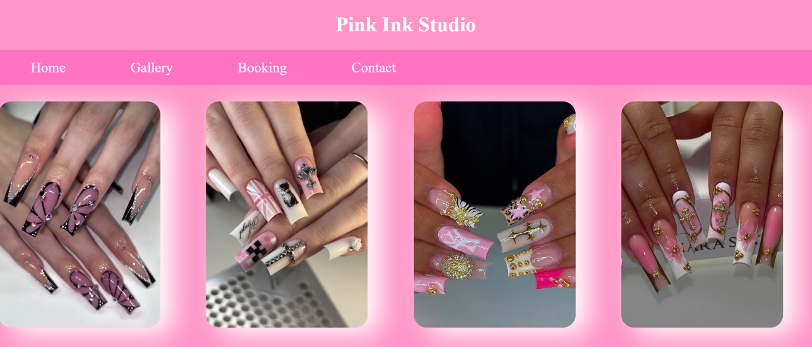
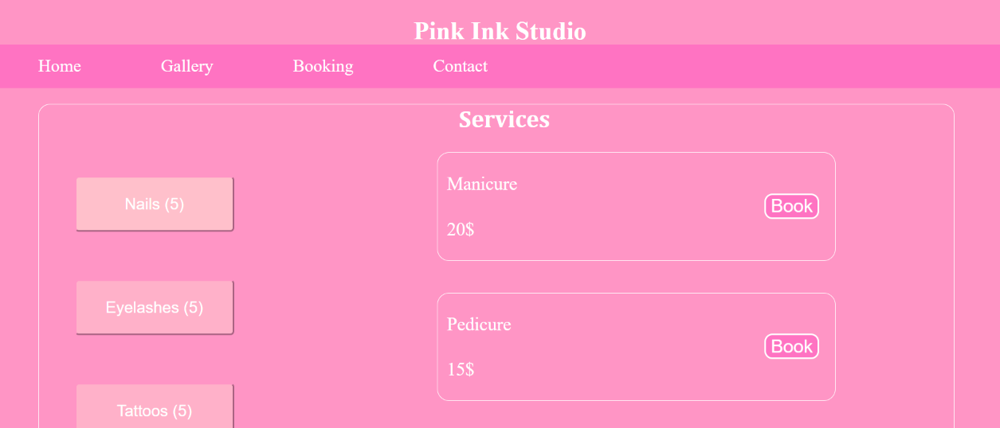
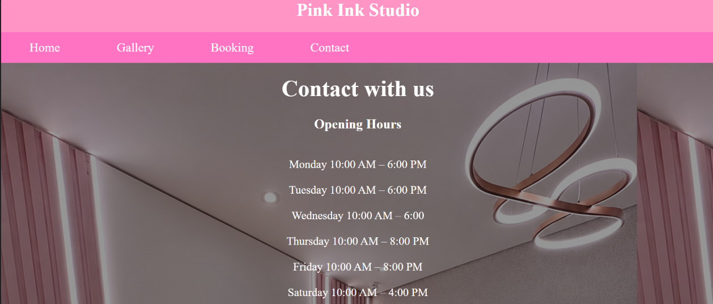
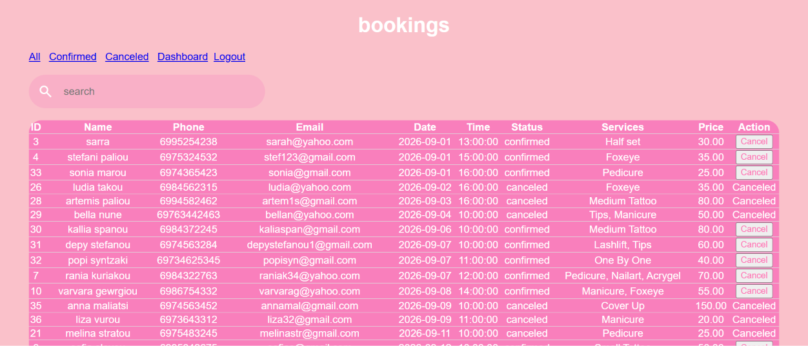

# PINK INK STUDIO
A full-stack booking website designed for a tattoo and beauty studio.

## About the project
Pink ink studio is a website that showcases the services of the studio. Furthermore, gives to users the ability to check availability, location of the studio, prices and book their appointment.The project is built using HTML, CSS, JavaScript, Python, Flask and MySQL. The goal of this project is, first of all, to help users have an easier and faster way to book their apointment and secondly to help the owners have organized their apointments in a list that they can access via the admin page with their passwords.

## Security
- Password hashing
- CSRF protection
- Environment variables
- Sessions
- Server-side validation
- Parameterized SQL queries

## How to run

### 1. First of all you need to clone the repository

```bash
git clone YOUR_REPOSITORY_URL
```
### 2. Create a virtual environment

```bash
python -m venv venv
```
### 3. Activate the virtual environment

```bash
venv\Scripts\activate
```
### 4. Install dependencies

```bash
pip install -r requirements.txt
```
### 5. Configure environment variables

```bash
create a .env file and add the requird configuration

```env
DB_HOST=
DB_USER=
DB_PASSWORD=
DB_NAME=
FLASK_SECRET_KEY=
ADMIN_USERNAME=
ADMIN_PASSWORD_HASH=
```
### 6. Run the application

```bash
python app.py
```
## Screenshots

### Home


### Gallery



### Booking



### Contact




### Admin


